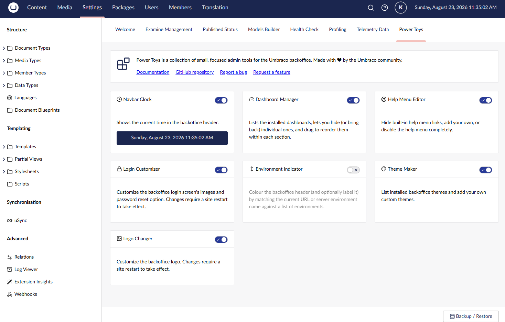

# Power Toys for Umbraco

A dashboard in the Umbraco Settings section that collects small backoffice admin tools
("power toys") in one place, each with its own on/off switch. Every tool registers itself
against a `powerToy` backoffice extension type, so both this package and other packages can
add tools to the same dashboard without touching Power Toys' own code.

## Getting started

See the [Installation](install.html) page to add the package to your site.

## Power toys

- [BackChat](power-toys/chat.html) - chat with other editors from the backoffice header, globally or about the page you're on.
- [Tasks](power-toys/tasks.html) - to-do lists for each page and for the whole site, from the backoffice header.
- [Navbar Clock](power-toys/navbar-clock.html) - shows the current time in the backoffice header.
- [Dashboard Manager](power-toys/dashboard-manager.html) - lists installed dashboards, lets you hide/reorder them.
- [Login Customizer](power-toys/login-customizer.html) - customizes the backoffice login screen.
- [Help Menu Editor](power-toys/help-menu-editor.html) - hides or adds links in the backoffice help menu.
- [Environment Indicator](power-toys/environment-indicator.html) - colours the backoffice header by environment.
- [Theme Maker](power-toys/theme-maker.html) - lists and adds custom backoffice themes.
- [Logo Changer](power-toys/logo-changer.html) - customizes the backoffice logo.
- [Backup/Restore](power-toys/backup-restore.html) - backs up and restores every power toy's settings.

## Links

- [NuGet package](https://www.nuget.org/packages/Umbraco.Community.PowerToys/)
- [Source on GitHub](https://github.com/Jumoo/umbraco.community.powertoys)
- [Report an issue](https://github.com/Jumoo/umbraco.community.powertoys/issues)
- [Contributing guidelines](https://github.com/Jumoo/umbraco.community.powertoys/blob/v17/main/.github/CONTRIBUTING.md)
