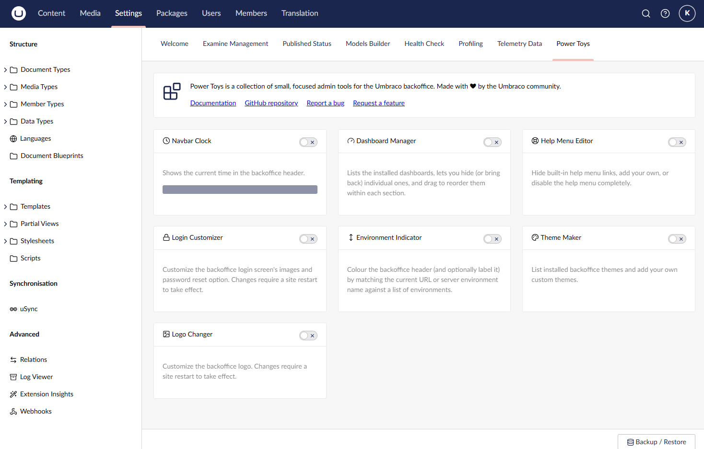

# Installation

Add the package to an existing Umbraco website (v17+) from NuGet:

```bash
dotnet add package Umbraco.Community.PowerToys
```

No configuration is required. A **Power Toys** dashboard appears under the Settings section on
first load. It starts out empty; tools are added by other packages (or later versions of this
one) registering a `powerToy` extension, at which point they show up on the dashboard
automatically with an enable/disable toggle, as below with all of this package's built-in tools
enabled. Each tool's settings (if it has any) are opened from its card on the dashboard.



Some power toys - Login Customizer and Logo Changer - note that changes require a site restart
to take effect; this is called out on their own pages.

[Back to overview](index.html)
