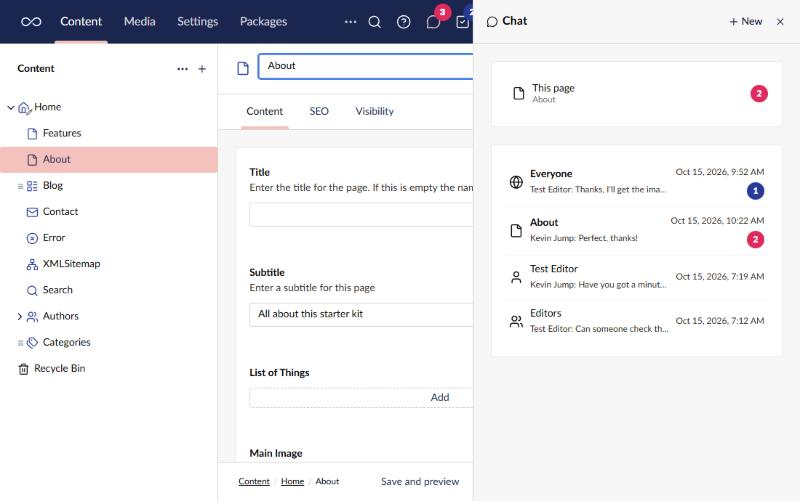
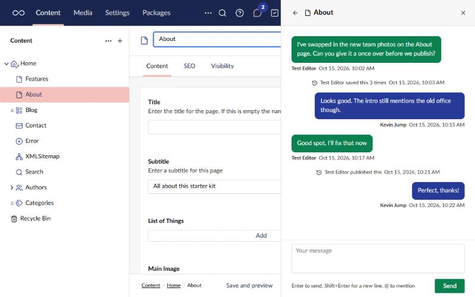
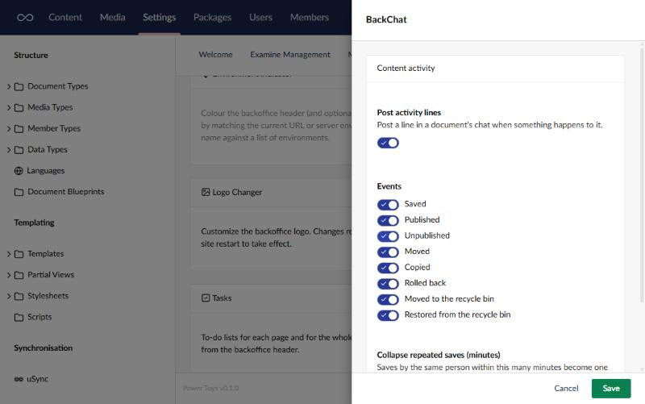

# BackChat

Chat with other editors from the backoffice header: everyone at once, about the page you have
open, or in a direct or group conversation.

Turn the tool on from its card on the Power Toys dashboard. A chat icon then appears in the
header for every user. It opens a panel beside the page, which stays open while you move
around the site, with:

- **Waiting for you to confirm** - messages someone has asked you to confirm you've read.
- **This page** - the chat about the document you have open. Only shown while a saved document
  is open.
- **Your conversations** - *Everyone*, your direct and group conversations, and document chats
  with something unread.



The header icon shows how many messages you haven't read, in red when one of them mentions you.



## What you can do

- **@mentions.** Type `@` to mention a person or, with permission, a user group. Mentioned people
  get a notification and a stronger badge.
- **Direct and group conversations.** Start one from *New* in the panel, with up to four other
  people or, with permission, a whole user group.
- **Messages that need confirming.** Ask everyone, a group or the people in a conversation to
  confirm they've read a message. Important ones stay on screen until confirmed. The sender can
  see who has confirmed and remind the rest.
- **Content activity.** Saves, publishes, moves and the rest post a short line in the document's
  chat. Repeated saves by the same person collapse into one line.

A document's chat is only visible to users who can browse that document.

## Settings

The card's settings choose whether content activity is posted, which events post a line, and how
many minutes of repeated saves collapse into one.



Like every power toy, the settings can be fixed in `appsettings.json` instead:

```json
"PowerToys": {
  "Chat": {
    "Enabled": true,
    "ActivityEnabled": true,
    "ActivityEvents": [ "Saved", "Published", "Unpublished", "Moved", "Copied", "RolledBack", "Trashed", "Restored" ],
    "CollapseMinutes": 30
  }
}
```

## Permissions

Chat adds its own permissions to the user group editor, under the *Chat permissions* heading. Administrators
get them all on install; other groups get none.

- Send important messages (and ask for confirmation)
- Message user groups
- Mention user groups

Plain chat and mentioning a person don't need a permission.

## Notes

- Chat history is stored in the site's database. Turning the tool off keeps the history; turning
  it back on brings it back.
- On a load-balanced backoffice, history is shared through the database, but live messages only
  reach users connected to the same server unless SignalR has a backplane configured.

[Back to overview](../index.html)
