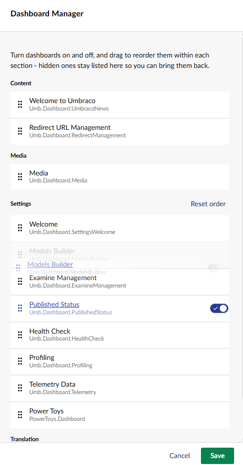

# Dashboard Manager

Lists the installed dashboards, lets you hide (or bring back) individual ones, and drag to
reorder them within each section.

Open the tool's settings from its card on the Power Toys dashboard. Ordering and visibility are
tracked per section, so each Umbraco section (Content, Media, Settings, etc.) keeps its own
custom dashboard order. A section only shows a "Reset order" option once you've actually
changed its order away from the default.

[Back to overview](../index.html)
