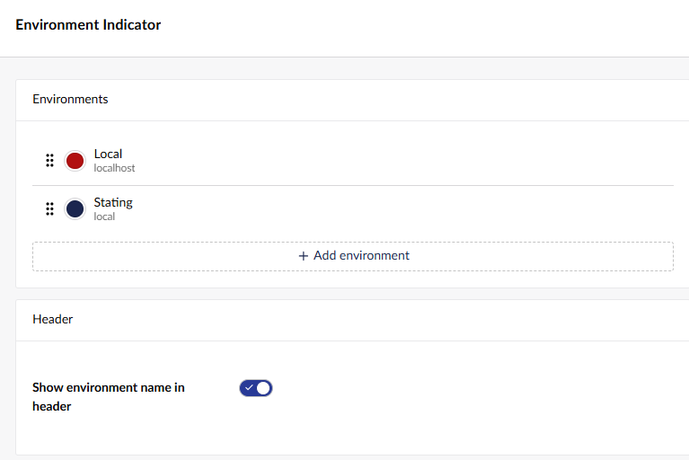
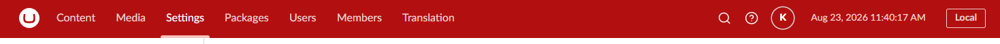

# Environment Indicator

Colour the backoffice header (and optionally label it) by matching the current URL or server
environment name against a list of environments you configure - for example, colouring
"staging" orange and "production" red so editors always know which site they're on.

Open the tool's settings from its card on the Power Toys dashboard, and use "Add environment"
to define a new match.

[Back to overview](../index.html)
