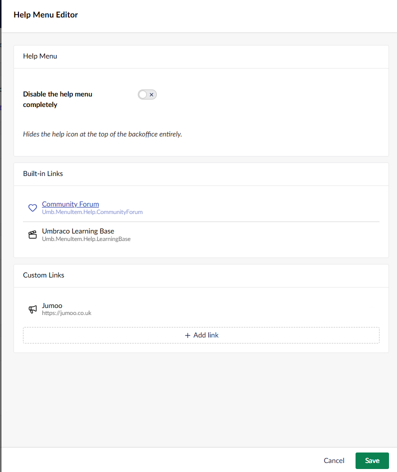
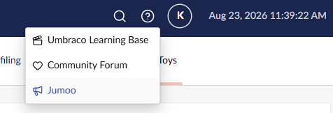

# Help Menu Editor

Hide built-in help menu links, add your own, or disable the help menu completely.

Open the tool's settings from its card on the Power Toys dashboard. Use "Add link" to add a
custom entry to the backoffice help menu.

[Back to overview](../index.html)
