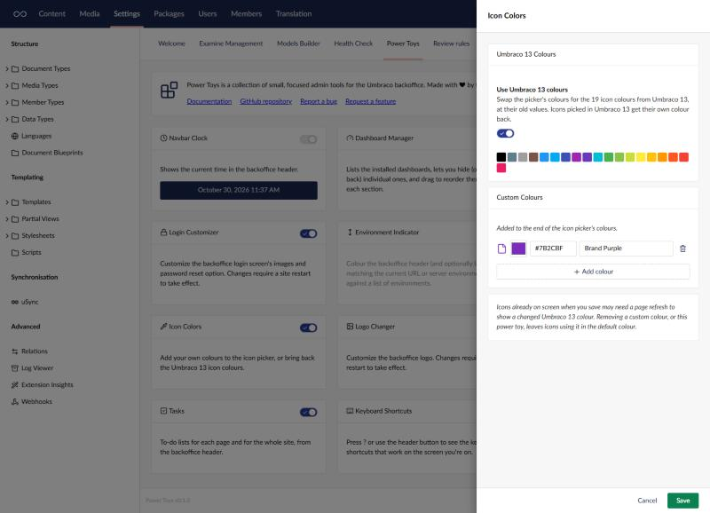
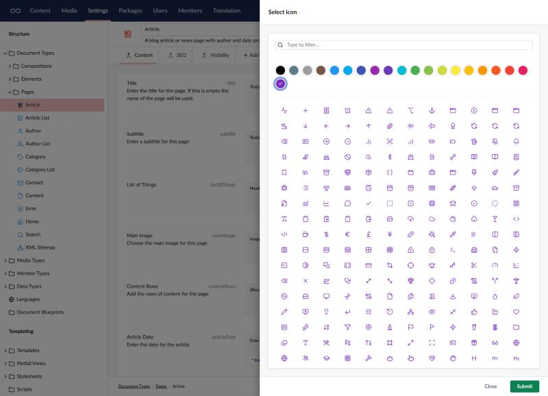

# Icon Colors

Add your own colours to the icon picker, or bring back the Umbraco 13 icon colours.

Umbraco 17's icon picker has eight colours and no setting to add more
([umbraco/Umbraco-CMS#22543](https://github.com/umbraco/Umbraco-CMS/issues/22543)). Open the
tool's settings from its card on the Power Toys dashboard to:

- **Use Umbraco 13 colours**: swap the picker's colours for the 19 from Umbraco 13, at their old
  values. Umbraco 17 still knows the old colour names but maps several to the same colour, so
  turning this on gives icons picked in v13 their own colour back without changing any content
  types.
- **Add custom colours**: give each one a name and a colour. They're added to the end of the
  picker's colours, for every backoffice user.

The colours then show up in the icon picker wherever you choose an icon, such as on a document
type.

## Things to know

- This works by changing the colour list inside the Umbraco backoffice, which isn't a public
  API. If a future Umbraco version changes it, the tool stops applying rather than breaking
  the backoffice, and says so in its settings.
- Removing a custom colour, or turning the tool off, leaves icons using it in the default colour.
  Turn it back on and they get their colour again.
- After switching the Umbraco 13 colours on or off, icons already on screen may need a page
  refresh to change.

[Back to overview](../index.html)
