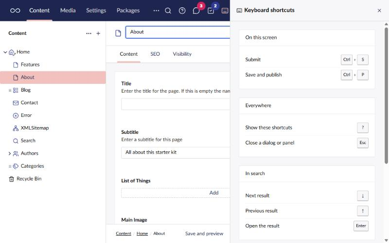
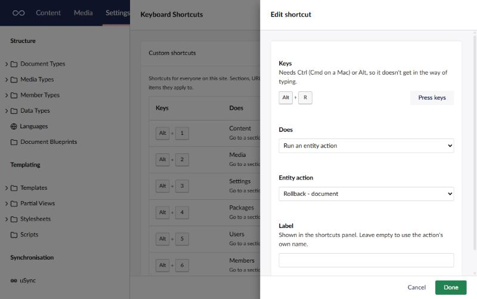

# Keyboard Shortcuts

Shows the keyboard shortcuts that work on the screen you're on.

Turn the tool on from its card on the Power Toys dashboard. Then press `?` anywhere in the
backoffice (except while you're typing in a field), or use the keyboard button in the header. A
panel opens beside the page, and stays open while you move around the site.

- **On this screen** - the shortcuts the item you have open registers, read live from Umbraco.
  On a page that's save (Ctrl+S) and save and publish (Ctrl+P); on most other items it's just
  save. Shortcuts that other packages register this way show up here too.
- **Everywhere, In search, In the rich text editor** - common keys Umbraco handles in its own
  components. They aren't registered anywhere Umbraco can list, so this part is a fixed list.

On a Mac the panel shows ⌘ instead of Ctrl, to match how Umbraco reads the keys.

## Your own shortcuts

Admins can add shortcuts for everyone on the site from the Keyboard Shortcuts card's settings.
Each one is a key combination, something to do, and an optional label for the panel.

A shortcut can:

- **Go to a section.** Out of the box, Alt+1 to Alt+9 go to the sections in the order the header
  shows them. Change or remove them like any other shortcut. Someone without access to a section
  isn't taken there.
- **Go to a URL.** A backoffice path such as `/umbraco/section/media` opens in place; a full
  link opens in a new tab.
- **Open search.**
- **Open a Power Toys panel:** BackChat, Tasks or Keyboard Shortcuts.
- **Run a workspace action,** such as Save and preview.
- **Run an entity action** on the item you have open, such as Rollback or Copy.

Section, URL, search and panel shortcuts work anywhere in the backoffice. Workspace and entity
actions only work where they apply: on the items they're for, and for people allowed to use
them. They show under "On this screen" when they do. Actions that other packages add can be
picked too.

A shortcut needs Ctrl (Cmd on a Mac) or Alt, so it never gets in the way of typing. Set the
keys with **Press keys** and then press the combination. The settings warn when the keys are
already taken: by another shortcut, by Umbraco's save and publish, by the rich text editor, or
by keys browsers keep for themselves (Ctrl+T, Ctrl+W, Ctrl+N).

The shortcuts can be set in `appsettings.json` instead, under `PowerToys:KeyboardShortcuts`, like
any power toy's settings.

[Back to overview](../index.html)
