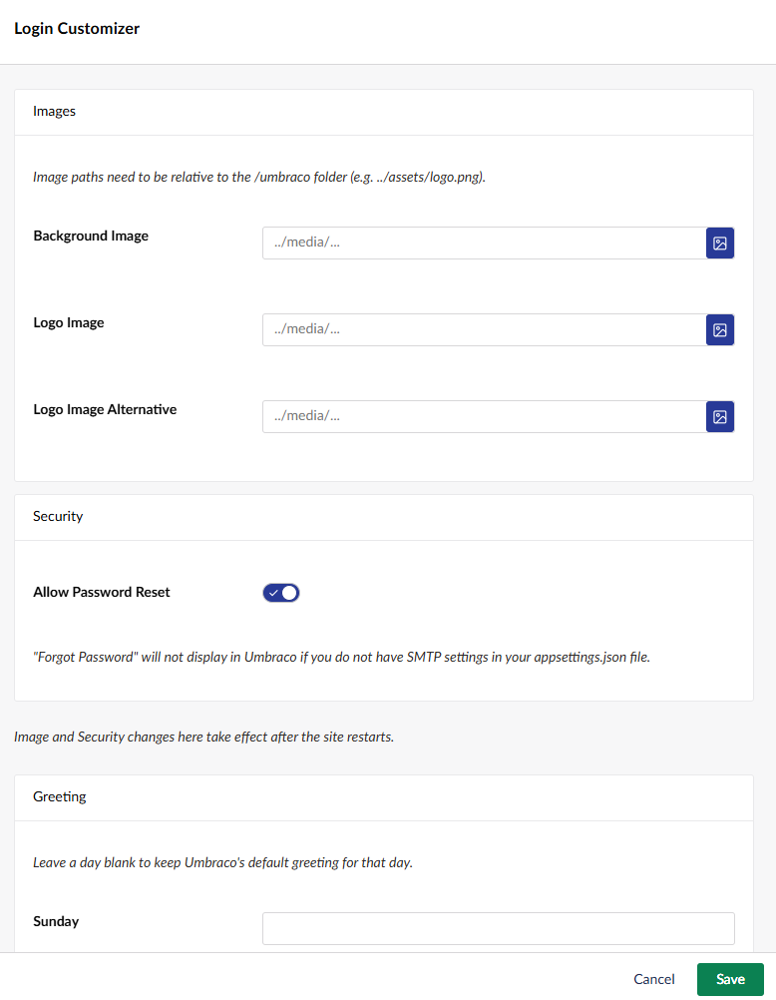
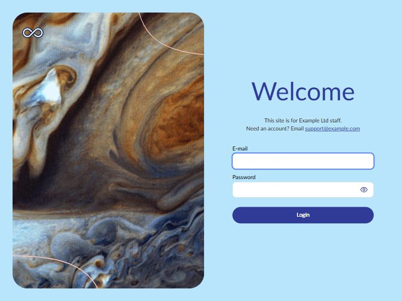
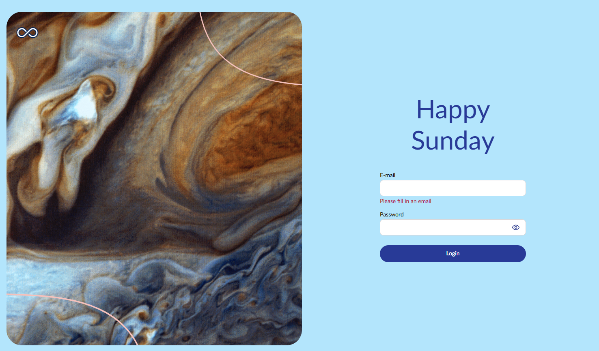

# Login Customizer

Customize the backoffice login screen: its images, greeting, a message for the people logging
in, custom CSS, and whether password reset is offered.

Open the tool's settings from its card on the Power Toys dashboard.

## Images and password reset

Set the background image, the logo, and the logo shown on light backgrounds, either by path or
by picking from the media library. Image paths are relative to the `/umbraco` folder.

**Image and password reset changes need a site restart to take effect.**

## Greeting

Replace Umbraco's greeting ("Welcome", "Happy Monday" and so on) with your own text for any day
of the week. Leave a day blank to keep Umbraco's greeting for that day.

The login screen uses the site's `Umbraco:CMS:Global:DefaultUILanguage`, and the greetings are
set for that language as well as English.

## Message

Add a few lines of text under the greeting, such as who the site is for or who to contact for an
account.

The message is plain text. Line breaks are kept, and email addresses and web addresses become
links. Anything that looks like HTML is shown as text, since the login screen is public.

The message replaces the old **Instruction** setting, which Umbraco 17's login screen no longer
shows. Any instruction you had saved is used as the message.

## Custom CSS

Style the login screen with CSS, for example with Umbraco's login screen variables. See the
[custom CSS properties reference](https://docs.umbraco.com/umbraco-cms/model-your-content/content-types-and-structure/backoffice/login#custom-css-properties-reference).
The message has the id `powertoys-login-message` if you want to style it.

Greeting, message and CSS changes show the next time the login screen loads. Umbraco caches the
greeting for a while in production, so it can take longer to change there.

[Back to overview](../index.html)
