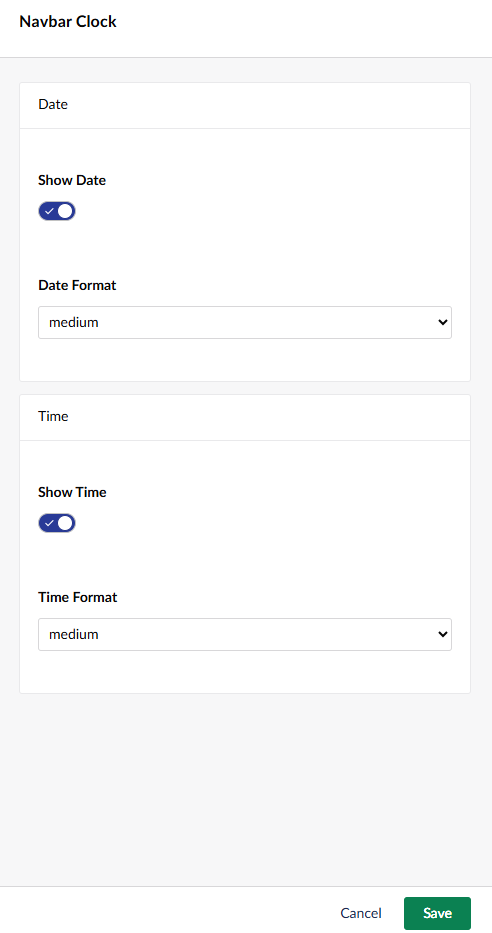

# Navbar Clock

Shows the current time in the backoffice header.

Enable the tool from its card on the Power Toys dashboard. Once enabled, the clock appears in
the backoffice header for every user, and its settings can be adjusted from the same card.

[Back to overview](../index.html)
