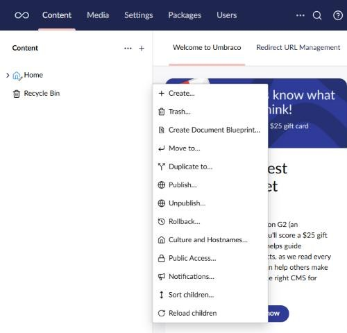

# Right-Click Actions

Right-click an item in the backoffice to open its actions menu, the same menu the "..." button
opens. Trees worked this way before Umbraco 14.

Enable the tool from its card on the Power Toys dashboard. It has no settings. Once enabled,
right-click works for every user on:

- items in the trees, such as content, media, and document types in Settings
- the header above a tree, such as "Content"
- cards and table rows in collections, such as the media grid or the list of data types

To get the browser's own menu, for example to open an item in a new tab, hold Shift while you
right-click. Right-clicking in a text field also keeps the browser's menu, so copy and paste
still work.

An item with a single action, such as an empty Recycle Bin, shows that action as a button
rather than a menu. Right-clicking it opens the browser's menu, so the action never runs by
accident.

The [Right Clicker](https://marketplace.umbraco.com/package/umbraco.community.rightclicker)
package does the same job for trees, if you want it without the rest of Power Toys.

[Back to overview](../index.html)
