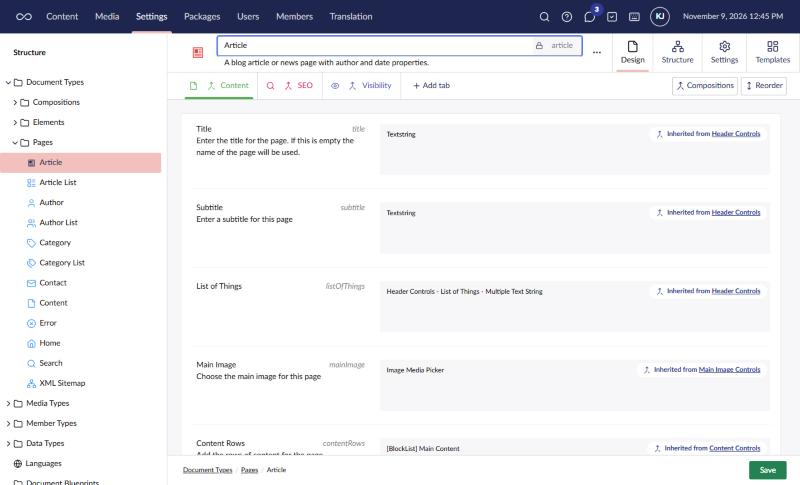
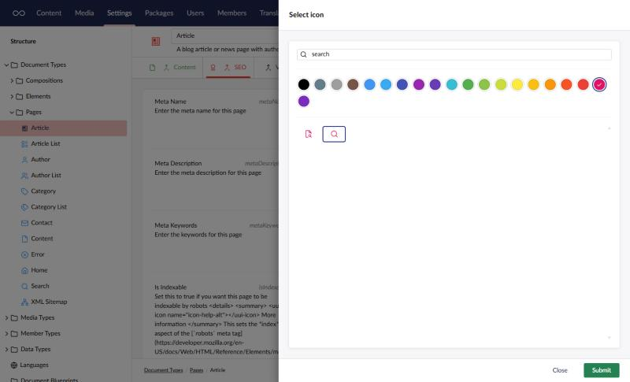
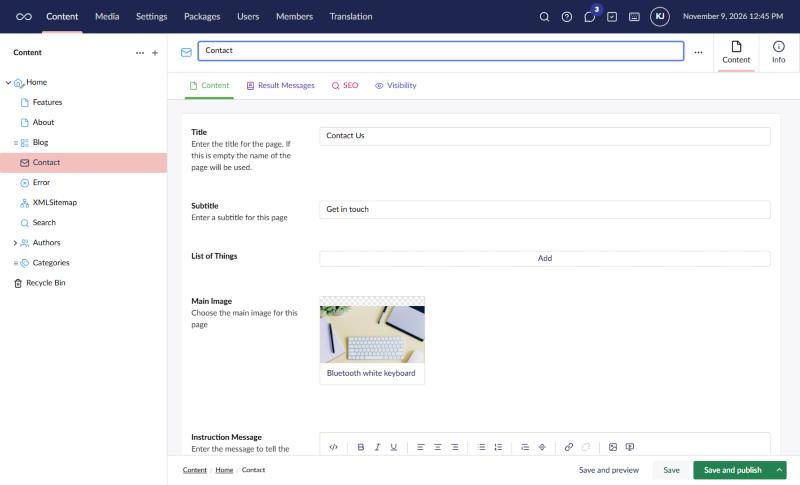
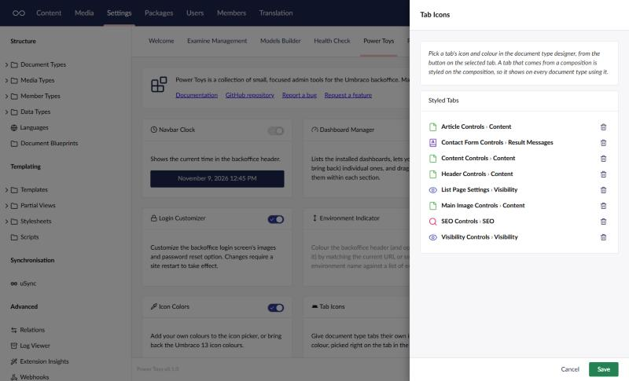

# Tab Icons

Give document type tabs their own icon and colour.

Once the tool is switched on, open a document type in **Settings**. The selected tab gets a
small button before its name. Click it to open Umbraco's icon picker, the same one you use for
a document type's icon, and pick an icon, a colour, or both. When the tab has an icon, the
icon itself is the button: click it to change the icon or colour. To clear a tab, pick no
icon and no colour.

Your choice is saved as soon as you submit the picker. It doesn't wait for the document
type's own **Save** button.

Editors then see the icons and colours on the tabs when they edit content, for documents,
media, blueprints and members.

## Compositions

A tab that comes from a composition is styled on the composition, so it shows on every
document type that uses it. In the screenshots above, the Content, SEO and Visibility tabs all
come from compositions, which is why the Contact page shows them as well as Article.

A document type's own tab is styled on that document type. If a tab is both the document
type's own and from a composition, the document type's own style wins.

## Settings

The tool's settings, opened from its card on the Power Toys dashboard, list every styled tab
and the document type or composition it belongs to. Use it to clear a style left behind by a
tab that was deleted, or that was added and then discarded without saving the document type.

## Things to know

- Umbraco has no extension point for tabs, so this works by hooking into the backoffice's
  own tab elements, which aren't a public API. If a future Umbraco version changes them, the
  tool stops styling tabs rather than breaking the backoffice.
- Styles are stored against each tab's id, so renaming a tab keeps its icon and colour, and
  uSync carries the ids between environments.
- Colours come from the icon picker, so any colours you add with [Icon Colors](icon-colors.html)
  can be used here too.
- Tabs on block element types aren't styled.
- If the settings are locked in `appsettings.json`, tabs show their icons but the button
  doesn't open the picker.

[Back to overview](../index.html)
