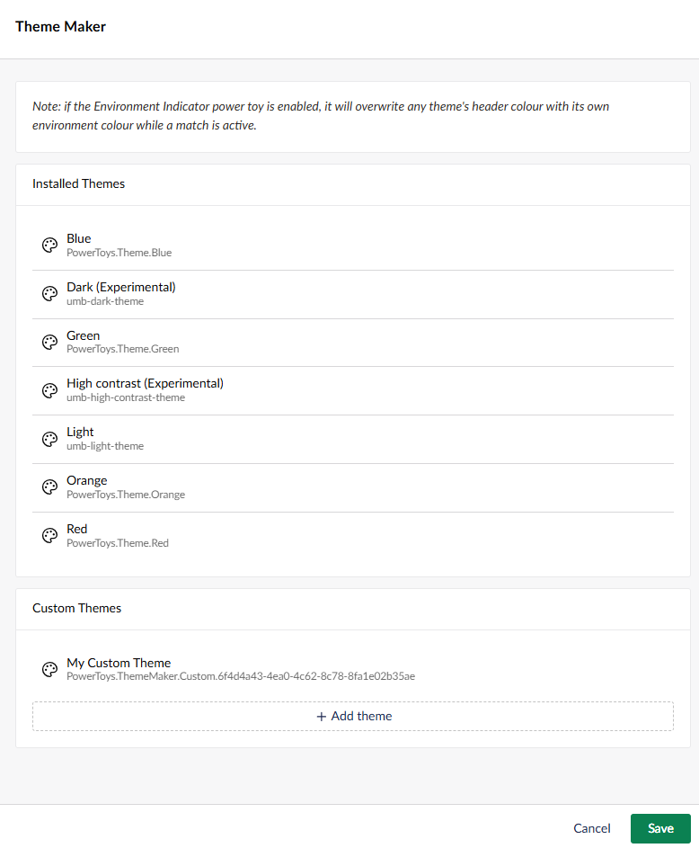
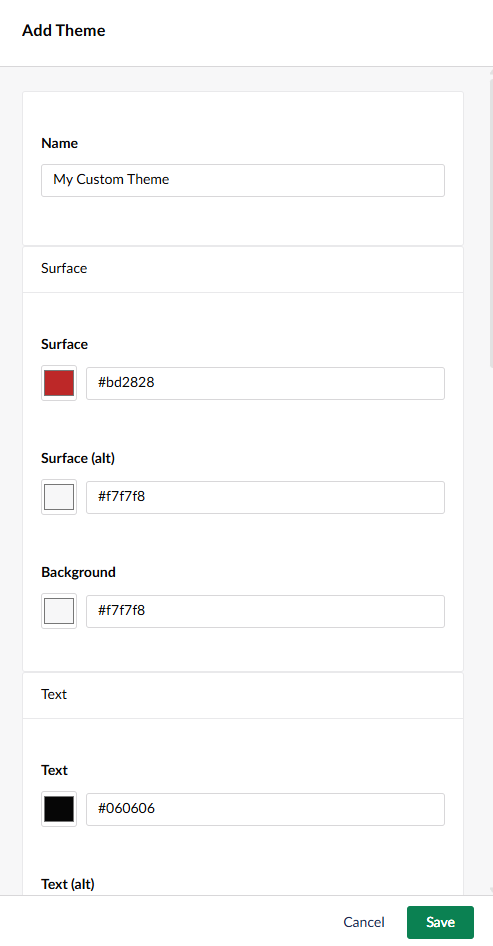
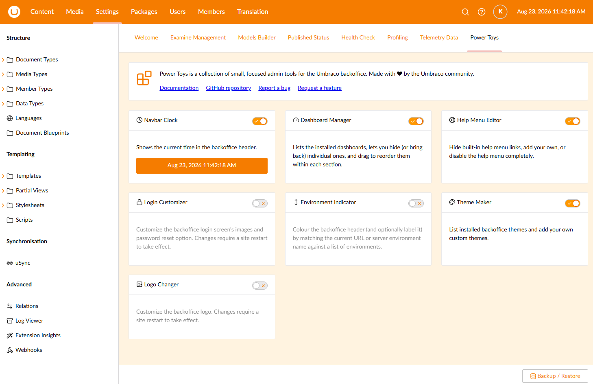

# Theme Maker

List installed backoffice themes and add your own custom themes.

Open the tool's settings from its card on the Power Toys dashboard, and use the editor to add or
edit a custom theme's colours.

[Back to overview](../index.html)
