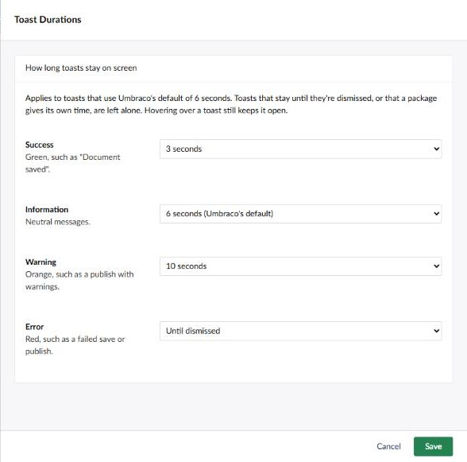

# Toast Durations

Choose how long the backoffice's toast notifications stay on screen. Umbraco shows every toast
for 6 seconds, whether it's a "Document saved" you don't need to read or an error you can't
afford to miss.

Enable the tool from its card on the Power Toys dashboard, then click the card to set a time for
each kind of toast:

| Toast | Colour | Default with this tool |
|---|---|---|
| Success | Green | 3 seconds |
| Information | Neutral | 6 seconds |
| Warning | Orange | 10 seconds |
| Error | Red | Until dismissed |

Each can be set from 2 to 30 seconds, until dismissed, or "Don't show". A hidden toast is still
read out by screen readers. The settings apply to every user.

Only toasts on Umbraco's default of 6 seconds change. A toast that's already set to stay until
it's dismissed, or that a package gives its own time, keeps it. Hovering over a toast still keeps
it open.

[Back to overview](../index.html)
